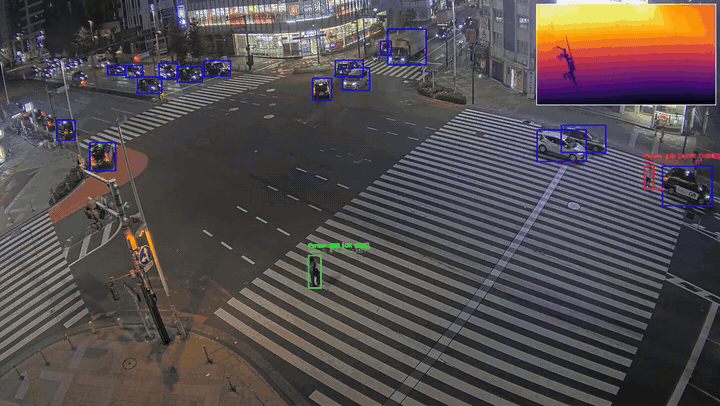
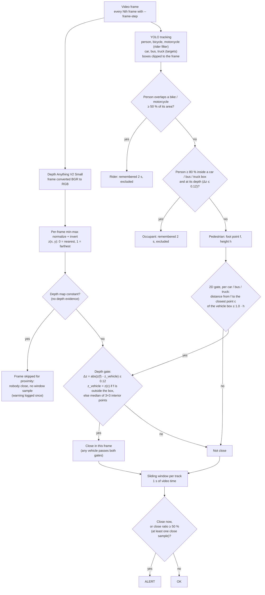

# Pedestrian-Vehicle Proximity Alert

Flags pedestrians that get close to cars, buses and trucks in a video, using YOLO tracking and monocular relative depth.

Each frame is processed with Depth Anything V2 Small (relative depth) and an Ultralytics YOLO tracker. Riders on
bicycles and motorcycles and occupants of cars, buses and trucks are filtered out; every remaining pedestrian is tested against each vehicle with a 2D
distance gate scaled by the person's height and a depth-difference gate. A short sliding time window per track
smooths the decision into an `OK` / `ALERT` state, and an annotated video is written.



## Features

- Tkinter setup window (input/output paths and alert parameters) or a full CLI.
- YOLO tracking of persons, bicycles, motorcycles, cars, buses and trucks.
- Rider filtering: persons overlapping a bicycle/motorcycle are excluded (2 s memory by default).
- Occupant filtering: persons mostly inside a car/bus/truck box and at its depth (drivers, passengers) are excluded
  (2 s memory, `--occupant-overlap`).
- Proximity targets are cars, buses and trucks only. Bicycles and motorcycles are detected and drawn, and used to
  recognize riders, but a pedestrian near one is never flagged.
- Two-stage proximity gate: 2D distance to the closest point of the vehicle box, then median-patch depth difference.
  When the foot is inside the vehicle box, the vehicle depth is the median of a 3×3 grid inside the box, so people
  standing in front of a vehicle are separated by depth.
- Frames whose depth map is constant (no depth evidence) are skipped for proximity instead of alerting every pair.
- Per-person sliding time window with a close-frame ratio.
- Annotated output video with contact lines, ratio and Delta Z labels, and a depth picture-in-picture.
- Live preview (press `Q` to stop) or headless mode (`--no-display`).

## How it works



Details, formulas and tuning tips: [docs/how-it-works.md](docs/how-it-works.md).

## Installation

Requires Python 3.9 or newer.

### Linux / macOS (bash)

```bash
git clone https://github.com/karemdm/pedestrian-vehicle-proximity-alert.git
cd pedestrian-vehicle-proximity-alert
python3 -m venv .venv
source .venv/bin/activate
pip install -r requirements.txt
pip install -e .          # installs the `proximity-alert` command
```

On Debian/Ubuntu, the setup window (Tkinter) and the OpenCV preview window need a few system packages:

```bash
sudo apt install python3-tk libgl1 libglib2.0-0
```

### Windows (PowerShell)

```powershell
git clone https://github.com/karemdm/pedestrian-vehicle-proximity-alert.git
cd pedestrian-vehicle-proximity-alert
python -m venv .venv
.venv\Scripts\Activate.ps1
pip install -r requirements.txt
pip install -e .          # installs the `proximity-alert` command
```

If PowerShell blocks the activation script, allow local scripts for the current session with
`Set-ExecutionPolicy -Scope Process RemoteSigned` and activate again.

### GPU and first run

A CUDA-capable GPU is strongly recommended: two networks run on every frame. Install the PyTorch build that matches
your CUDA version from [pytorch.org](https://pytorch.org) before the other requirements. The depth model runs on GPU
automatically when CUDA is available.

The default detector is `yolo26x.pt`, which is not stored in this repository. On first run Ultralytics downloads it
and `transformers` downloads the depth model (internet access required). The lighter `weights/yolo26m.pt` ships with
the repository and needs no YOLO download: pass `--model weights/yolo26m.pt`. See [weights/README.md](weights/README.md).

## Results

Example outputs produced by this project (re-encoded to H.264, 1280×720, no audio). They were produced before the
vehicle-depth and occupant changes described below, so people standing in front of or inside a vehicle may be alerted
in them; re-running the commands gives the current behaviour.

| File | Content |
|---|---|
| [`results/abbey_road_proximity.mp4`](results/abbey_road_proximity.mp4) | Zebra crossing at night (60 s, `--model weights/yolo26m.pt --frame-step 2`): pedestrians on the pavement and the crossing next to passing cars and vans, which are tracked as targets, with alert states and the depth picture-in-picture. A truck and a double-decker bus pass right next to the camera, partly out of frame, and are missed by `yolo26m` in most frames (no box, so no alert for them). |
| [`results/shinjuku_proximity.mp4`](results/shinjuku_proximity.mp4) | Night-time intersection (60 s): pedestrians crossing near cars (many of them taxis) and trucks, with alert states and the depth picture-in-picture. |

Try it on the sample clip in [`samples/`](samples/README.md):

```bash
proximity-alert -i samples/abbey_road_25s.mp4 -o outputs/abbey_road.mp4 --model weights/yolo26m.pt --frame-step 2
```

Source footage and attribution: see [results/README.md](results/README.md).

## Usage

```bash
# Setup window (no --input)
proximity-alert

# CLI
proximity-alert -i input.mp4 -o outputs/result.mp4

# Lighter shipped model, headless
proximity-alert -i input.mp4 -o outputs/result.mp4 --model weights/yolo26m.pt --no-display

# Stricter depth gate, longer window
proximity-alert -i input.mp4 -o outputs/result.mp4 --depth-threshold 0.08 --time-window 2.0

# Setup window prefilled with CLI values
proximity-alert --gui --depth-threshold 0.10

# Module form
python -m proximity_alert --help
```

## Parameters

| Name | Default | Description |
|---|---|---|
| `-i, --input` | — | Input video. If omitted, the setup window opens. |
| `-o, --output` | — | Output MP4 (required with `--input` unless `--gui` is used); must differ from the input path. |
| `--gui` | off | Open the setup window prefilled with the CLI values. |
| `--model` | `yolo26x.pt` | YOLO weights path or official name (auto-downloaded). The shipped lighter model is `weights/yolo26m.pt`. |
| `--depth-model` | `depth-anything/Depth-Anything-V2-Small-hf` | Hugging Face depth model id. |
| `--imgsz` | `1280` | YOLO inference size. |
| `--conf` | `0.10` | YOLO confidence threshold (0-1). |
| `--time-window` | `1.0` | Sliding window length in seconds of video time (greater than 0). |
| `--min-ratio` | `50` | Percentage (0-100) of close frames in the window that triggers an alert (an alert always needs at least one close frame). |
| `--depth-threshold` | `0.12` | Max \|z_person − z_vehicle\| on the per-frame normalized depth map z in [0, 1] (0 or more). |
| `--height-factor` | `1.0` | 2D gate radius as a multiple of the person box height (greater than 0). |
| `--rider-overlap` | `0.50` | Fraction (0-1) of the person box covered by a bicycle/motorcycle to be a rider. |
| `--occupant-overlap` | `0.80` | Fraction (0-1) of the person box inside a car/bus/truck box (and at the vehicle's depth) to be an occupant, excluded like a rider. |
| `--rider-memory` | `2.0` | Seconds the rider or occupant status persists after the last overlap (0 or more). |
| `--depth-patch` | `7` | Side in pixels of the median depth patch (at least 1; even values are rounded up to odd). |
| `--pip-scale` | `0.25` | Size of the depth picture-in-picture relative to the frame (between 0 and 1, exclusive). |
| `--frame-step` | `1` | Process every Nth frame (at least 1). The output is written at `fps / N`, so it keeps the original speed. |
| `--no-display` | off | Do not open the live preview window. |
| `--log-level` | `INFO` | Logging verbosity. |
| `--version` | — | Print the version and exit. |

Numeric values are validated before processing: out-of-range values are rejected with a message (a CLI error, or a
dialog in the setup window). The setup window exposes input/output, `imgsz`, `conf`, time window, min ratio, depth
threshold, height factor and frame step; the other options keep the values given on the command line (or the defaults).

## Faster processing

`--frame-step N` runs depth and tracking on every Nth frame only and writes the output at `fps / N`, so the video plays
at the original speed (with fewer frames). The sliding time window and the rider memory use that effective frame rate,
so `--time-window 1.0` is still one second of video; a window holds fewer samples at higher steps. Skipped frames are
not drawn. Large steps make tracking harder (objects move farther between processed frames), so keep `N` small.

A track that is not detected for a few processed frames keeps its window and is forgotten only after a grace period of
the time window (at least 1 s of video time), so a missed detection does not reset the ratio.

```bash
proximity-alert -i input.mp4 -o outputs/result.mp4 --frame-step 3 --no-display
```

## Output

- An MP4 video (`mp4v`, same resolution as the input, same FPS divided by `--frame-step`) with:
  - target vehicles (cars, buses, trucks) in blue, bicycles/motorcycles in cyan;
  - riders in orange (`Rider #id`) and occupants of vehicles in magenta (`Occupant #id`);
  - pedestrians in green (`OK`) or red (`ALERT`), labeled `Person #id [STATUS (ratio%)]` and
    `Delta Z: <min Δz> (Z: <person z>)` (`N/A` when no vehicle passed the 2D gate), with lines from the foot point to
    each vehicle contact point (yellow while `OK`, red during an `ALERT`);
  - the colorized depth map `z` (INFERNO: near = dark, far = bright) with a white border, at `--pip-scale` (25 % by
    default) of the frame size in the top-right corner.
- A progress line in the terminal with the frame count and processing FPS. The exit code is 0 on success and 1 if the
  input or output cannot be opened, the paths are equal, or no frame could be read.

No alert log or event file is written; alerts exist only as video annotations.

## Project structure

```
pedestrian-vehicle-proximity-alert/
├── README.md
├── LICENSE
├── pyproject.toml
├── requirements.txt
├── docs/
│   ├── how-it-works.md
│   └── assets/demo.gif
├── results/
│   ├── README.md
│   ├── abbey_road_proximity.mp4
│   └── shinjuku_proximity.mp4
├── samples/
│   ├── README.md
│   └── abbey_road_25s.mp4
├── weights/
│   ├── README.md
│   └── yolo26m.pt
├── src/proximity_alert/
│   ├── __init__.py
│   ├── __main__.py
│   ├── cli.py          # argparse entry point
│   ├── config.py       # Config dataclass, class ids and frame-step helpers
│   ├── depth.py        # Depth Anything V2 wrapper, normalization, median patch
│   ├── geometry.py     # box helpers, closest point, rider overlap (stdlib)
│   ├── gui.py          # Tkinter setup window
│   ├── pipeline.py     # video loop
│   ├── proximity.py    # per-frame gates, alert state, track grace period (stdlib)
│   ├── rendering.py    # drawing and picture-in-picture
│   ├── temporal.py     # sliding window and rider memory (stdlib)
│   └── validation.py   # parameter checks shared by CLI and setup window (stdlib)
└── tests/
    ├── test_cli.py
    ├── test_depth.py
    ├── test_docs.py
    ├── test_frame_step.py
    ├── test_geometry.py
    ├── test_pipeline_run.py
    ├── test_proximity.py
    ├── test_rendering.py
    ├── test_rider.py
    ├── test_split_detections.py
    ├── test_temporal.py
    ├── test_track_gap.py
    └── test_validation.py
```

Run the tests with `pytest` (no models or GPU needed: they use synthetic arrays and fake detectors, and only need the
requirements plus `src` on the path, e.g. after `pip install -e .` or with `PYTHONPATH=src`).

## Limitations

- **Research prototype, not a certified safety system.** It must not be used to make safety-critical decisions.
- **Monocular relative depth, not metric.** Depth Anything V2 predicts relative depth; no distance in meters is computed.
- **Per-frame min-max normalization.** The depth range changes with scene content (sky, far background, a large
  vehicle close to the camera), so `--depth-threshold` is scene-dependent and the same physical gap can give
  different `Δz` in different frames.
- **Depth convention.** Depth Anything V2 outputs relative *inverse* depth (higher = nearer); the map is inverted as in
  the original prototype, so `z = 0` is the nearest and `z = 1` the farthest surface of the frame. `z` is 8-bit
  quantized and not linear in distance (a given `Δz` is a smaller metric gap near the camera than far away). The gates
  use `|Δz|`, which the inversion does not change.
- **2D gate in image space.** The radius scales with the person's box height, which is only a rough perspective proxy;
  partially visible or occluded people get a smaller radius.
- **Tracking quality drives the result.** ID switches reset the time window and the rider memory. If the tracker
  returns no IDs, per-frame detection indices are used (a warning is logged) and temporal smoothing is unreliable.
- **Vehicle depth inside the box is approximate.** When the foot lies inside a car/bus/truck box, the vehicle depth is
  the median of a 3×3 grid in the middle half of the box (points covered by the person are ignored). Boxes of large or
  oblique vehicles can contain background or other objects there, and a person at nearly the vehicle's depth (within
  `--depth-threshold`) is still treated as close, or as an occupant if the box is mostly inside the vehicle.
- **Occupants need depth and overlap.** A person is an occupant only if at least `--occupant-overlap` of the box is
  inside a vehicle box and the person is at the vehicle's depth; a pedestrian right behind a car window or crossing
  just in front of a bus at the same depth can be misclassified. The status is remembered for `--rider-memory`.
- **Degenerate depth frames.** If the depth map of a frame is constant (e.g. a black frame), the frame is skipped for
  proximity: nobody is close in it, no sample is added to the windows, and a warning is logged once. Alert states
  come from the windows of the neighbouring frames.
- Riders are detected only by box overlap; a pedestrian standing next to a parked bicycle may be excluded, and a
  rider whose box overlaps the bike less than `--rider-overlap` (50 % by default) is treated as a pedestrian.
- Bicycles and motorcycles are not proximity targets: only cars, buses and trucks are checked.
- Two large networks per frame: processing is slow on CPU.
- No quantitative evaluation is provided.

## Models & credits

- [Ultralytics YOLO](https://github.com/ultralytics/ultralytics) (YOLO26 weights) — AGPL-3.0.
- [Depth Anything V2](https://github.com/DepthAnything/Depth-Anything-V2) Small via
  [Hugging Face](https://huggingface.co/depth-anything/Depth-Anything-V2-Small-hf) — Apache-2.0.
- [Hugging Face Transformers](https://github.com/huggingface/transformers) — Apache-2.0.
- [OpenCV](https://opencv.org) — Apache-2.0.
- COCO class definitions used by the YOLO weights.

See [weights/README.md](weights/README.md) for model files and sizes.

## License

AGPL-3.0, because the project depends on Ultralytics YOLO (AGPL-3.0). See the `LICENSE` file.
