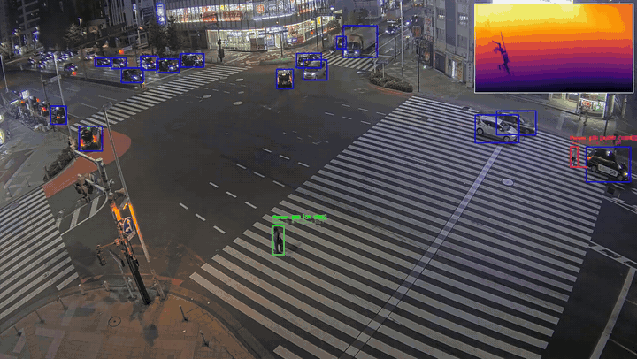

# Pedestrian-Vehicle Proximity Alert

Flags pedestrians that get close to cars, buses and trucks in a video, using YOLO tracking and monocular relative depth.

Each frame is processed with Depth Anything V2 Small (relative depth) and an Ultralytics YOLO tracker. Riders on
bicycles and motorcycles are filtered out; every remaining pedestrian is tested against each vehicle with a 2D
distance gate scaled by the person's height and a depth-difference gate. A short sliding time window per track
smooths the decision into an `OK` / `ALERT` state, and an annotated video is written.


<!-- add a short demo GIF here -->

## Features

- Tkinter setup window (input/output paths and alert parameters) or a full CLI.
- YOLO tracking of persons, bicycles, motorcycles, cars, buses and trucks.
- Rider filtering: persons overlapping a bicycle/motorcycle are excluded, with a 2 s memory.
- Two-stage proximity gate: 2D distance to the closest point of the vehicle box, then median-patch depth difference.
- Per-person sliding time window with a close-frame ratio.
- Annotated output video with contact lines, ratio and Delta Z labels, and a depth picture-in-picture.
- Live preview (press `Q` to stop) or headless mode (`--no-display`).

## How it works

```
video frame
   ├─► Depth Anything V2 Small ─► per-frame min-max normalize + invert ─► z(x, y)
   └─► YOLO track (person, bicycle, motorcycle, car, bus, truck)
            │
            ├─ person ∩ bike/motorcycle ≥ 50 % of person area ─► rider (remembered 2 s, excluded)
            ▼
        pedestrian foot point f, height h
            │  2D gate: ‖f − closest point of vehicle box‖ ≤ 1.0 · h
            │  depth gate: |z(f) − z(contact)| ≤ 0.12   (7×7 median)
            ▼
        close? ─► 1 s sliding window ─► ALERT if ratio ≥ 50 % or close now
```

Details, formulas and tuning tips: [docs/how-it-works.md](docs/how-it-works.md).

## Installation

```bash
python -m venv .venv
# Windows: .venv\Scripts\activate    Linux/macOS: source .venv/bin/activate
pip install -r requirements.txt
pip install -e .          # installs the `proximity-alert` command
```

A CUDA-capable GPU is strongly recommended: two networks run on every frame. Install the PyTorch build that matches
your CUDA version from [pytorch.org](https://pytorch.org) before the other requirements. The depth model runs on GPU
automatically when CUDA is available.

On first run, Ultralytics downloads `yolo26x.pt` and `transformers` downloads the depth model (see
[weights/README.md](weights/README.md)).

## Results

Example outputs produced by this project (re-encoded to H.264, max 1920 px wide, no audio):

| File | Content |
|---|---|
| [`results/shinjuku_proximity.mp4`](results/shinjuku_proximity.mp4) | Night-time intersection: pedestrians crossing near cars, buses and trucks, with alert states and the depth picture-in-picture. |

Source footage and attribution: see [results/README.md](results/README.md).

## Usage

```bash
# Setup window (no --input)
proximity-alert

# CLI
proximity-alert -i input.mp4 -o outputs/result.mp4

# Lighter shipped model, headless
proximity-alert -i input.mp4 -o outputs/result.mp4 --model weights/yolo26m.pt --no-display

# Stricter depth gate, longer window
proximity-alert -i input.mp4 -o outputs/result.mp4 --depth-threshold 0.08 --time-window 2.0

# Setup window prefilled with CLI values
proximity-alert --gui --depth-threshold 0.10

# Module form
python -m proximity_alert --help
```

## Parameters

| Name | Default | Description |
|---|---|---|
| `-i, --input` | — | Input video. If omitted, the setup window opens. |
| `-o, --output` | — | Output MP4 (required with `--input`). |
| `--gui` | off | Open the setup window prefilled with the CLI values. |
| `--model` | `yolo26x.pt` | YOLO weights path or official name (auto-downloaded). |
| `--depth-model` | `depth-anything/Depth-Anything-V2-Small-hf` | Hugging Face depth model id. |
| `--imgsz` | `1280` | YOLO inference size. |
| `--conf` | `0.10` | YOLO confidence threshold. |
| `--time-window` | `1.0` | Sliding window length in seconds. |
| `--min-ratio` | `50` | Percentage of close frames in the window that triggers an alert. |
| `--depth-threshold` | `0.12` | Max \|z_person − z_vehicle\| on the normalized depth map. |
| `--height-factor` | `1.0` | 2D gate radius as a multiple of the person box height. |
| `--rider-overlap` | `0.50` | Fraction of the person box covered by a bicycle/motorcycle to be a rider. |
| `--rider-memory` | `2.0` | Seconds the rider status persists after the last overlap. |
| `--depth-patch` | `7` | Side in pixels of the median depth patch. |
| `--pip-scale` | `0.25` | Size of the depth picture-in-picture relative to the frame. |
| `--no-display` | off | Do not open the live preview window. |
| `--log-level` | `INFO` | Logging verbosity. |

The setup window exposes input/output, `imgsz`, `conf`, time window, min ratio, depth threshold and height factor.

## Output

- An MP4 video (`mp4v`, same resolution and FPS as the input) with:
  - target vehicles in blue, bicycles/motorcycles in cyan;
  - riders in orange (`Rider #id`);
  - pedestrians in green (`OK`) or red (`ALERT`), labeled `Person #id [STATUS (ratio%)]` and
    `Delta Z: <min Δz> (Z: <person z>)`, with lines from the foot point to each vehicle contact point;
  - the colorized depth map (INFERNO) at 25 % size in the top-right corner.
- A progress line in the terminal with the frame count and processing FPS.

No alert log or event file is written; alerts exist only as video annotations.

## Project structure

```
pedestrian-vehicle-proximity-alert/
├── README.md
├── pyproject.toml
├── requirements.txt
├── docs/
│   └── how-it-works.md
├── weights/
│   └── README.md
├── src/proximity_alert/
│   ├── __init__.py
│   ├── __main__.py
│   ├── cli.py          # argparse entry point
│   ├── config.py       # Config dataclass and class ids
│   ├── depth.py        # Depth Anything V2 wrapper, normalization, median patch
│   ├── geometry.py     # box helpers, closest point, rider overlap (stdlib)
│   ├── gui.py          # Tkinter setup window
│   ├── pipeline.py     # video loop
│   ├── proximity.py    # per-frame gates and alert state (stdlib)
│   ├── rendering.py    # drawing and picture-in-picture
│   └── temporal.py     # sliding window and rider memory (stdlib)
└── tests/
    ├── test_geometry.py
    ├── test_proximity.py
    ├── test_rider.py
    └── test_temporal.py
```

Run the tests with `pytest` (they only need the standard library and `src` on the path, e.g. `pip install -e .`).

## Limitations

- **Research prototype, not a certified safety system.** It must not be used to make safety-critical decisions.
- **Monocular relative depth, not metric.** Depth Anything V2 predicts relative depth; no distance in meters is computed.
- **Per-frame min-max normalization.** The depth range changes with scene content (sky, far background, a large
  vehicle close to the camera), so `--depth-threshold` is scene-dependent and the same physical gap can give
  different `Δz` in different frames.
- **Depth sign convention.** The map is inverted as in the original prototype (intended: higher = closer), but Depth
  Anything already outputs inverse depth; the gates use `|Δz|` and are unaffected, but the `Z` label may be reversed.
- **2D gate in image space.** The radius scales with the person's box height, which is only a rough perspective proxy;
  partially visible or occluded people get a smaller radius.
- **Tracking quality drives the result.** ID switches reset the time window and the rider memory. If the tracker
  returns no IDs, per-frame detection indices are used (a warning is logged) and temporal smoothing is unreliable.
- Riders are detected only by box overlap; a pedestrian standing next to a parked bicycle may be excluded, and a
  rider whose box overlaps the bike less than 50 % is treated as a pedestrian.
- Two large networks per frame: processing is slow on CPU.
- No quantitative evaluation is provided.

## Models & credits

- [Ultralytics YOLO](https://github.com/ultralytics/ultralytics) (YOLO26 weights) — AGPL-3.0.
- [Depth Anything V2](https://github.com/DepthAnything/Depth-Anything-V2) Small via
  [Hugging Face](https://huggingface.co/depth-anything/Depth-Anything-V2-Small-hf) — Apache-2.0.
- [Hugging Face Transformers](https://github.com/huggingface/transformers) — Apache-2.0.
- [OpenCV](https://opencv.org) — Apache-2.0.
- COCO class definitions used by the YOLO weights.

See [weights/README.md](weights/README.md) for model files and sizes.

## License

AGPL-3.0, because the project depends on Ultralytics YOLO (AGPL-3.0). See the `LICENSE` file.
