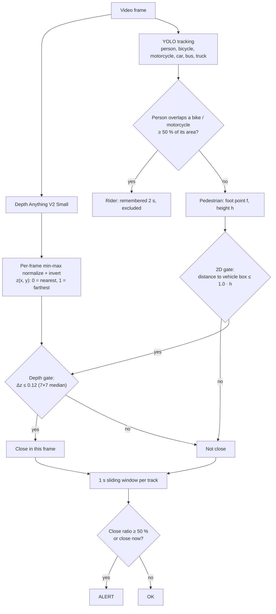

# How it works

The pipeline processes a video frame by frame. Each frame goes through relative
depth estimation, object tracking, rider filtering, a two-stage proximity gate
and a temporal smoothing step.



## 1. Relative depth

Depth Anything V2 Small (`depth-anything/Depth-Anything-V2-Small-hf`) is run via the
`transformers` `depth-estimation` pipeline. The model predicts *relative inverse
depth* (disparity-like: larger = nearer). The pipeline's `depth` output `d` is that
prediction resized to the frame size and min-max scaled to an 8-bit image
(0 = farthest, 255 = nearest surface of the frame). It is then normalized again and
**inverted**, as in the original prototype:

```
z = 1 - (d - min(d)) / (max(d) - min(d))      (z = 1 everywhere if max - min <= 1e-5)
```

So **`z = 0` is the nearest and `z = 1` the farthest surface of the current frame**
(higher `z` = farther). This is what the `Z:` label shows; in the INFERNO depth PiP,
near surfaces are dark and far surfaces bright.

Properties of `z` to keep in mind:

- It is relative and per frame (re-scaled on every frame), not a distance in meters.
- It is an inverted *inverse* depth, so equal steps in `z` are not equal steps in
  distance: a given `Δz` corresponds to a much smaller metric gap near the camera
  than far away.
- It is quantized to 256 levels (the pipeline's 8-bit output), so the default
  `depth_threshold = 0.12` is about 31 levels.

The gates only use `|Δz|`, which is identical with or without the inversion, so the
inversion affects only the `Z` label and the PiP colors, not the alerts.

Depth at a point is the median of a 7×7 patch (`--depth-patch`) around it, which
suppresses single-pixel noise and edge artifacts.

## 2. Detection and tracking

Ultralytics YOLO (`yolo26x.pt` by default, `imgsz=1280`, `conf=0.10`) is run with
`track(persist=True)`, restricted to COCO classes:

| Role | Classes |
|---|---|
| Person | person (0) |
| Rider vehicle | bicycle (1), motorcycle (3) |
| Target vehicle | car (2), bus (5), truck (7) |

Boxes are clipped to the frame. If the tracker returns no ids, the detection index
is used as id; such ids are not stable between frames and a warning is logged.

## 3. Rider filtering

A person is a **rider** in the current frame if any bicycle/motorcycle box covers at
least `rider_overlap` (0.50) of the person's box area:

```
overlap = area(person ∩ vehicle) / area(person)
```

The rider status is remembered for `rider_memory` (2.0 s) after the last overlap,
so short occlusions or box jitter do not turn a rider into a pedestrian. Riders are
drawn but never raise an alert. Memory entries older than `2 × rider_memory` are
removed.

## 4. Proximity gates (per pedestrian, per target vehicle)

Let `f = (x_f, y_f)` be the foot point (bottom-center of the person box) and `h`
the person box height (at least 10 px).

1. **2D gate**: `c` = closest point of the vehicle box to `f`.
   Pass if `‖f - c‖ ≤ height_factor × h` (default `1.0 × h`). Using the person height
   makes the radius scale with the apparent size of the person (perspective).
2. **Depth gate**: `Δz = |z(f) - z(c)|`. Pass if `Δz ≤ depth_threshold` (0.12).
   Sampling the vehicle at the contact point `c` (rather than its center) compares
   depths at the part of the vehicle closest to the person.

A pedestrian is *currently close* if any vehicle passes both gates. The smallest
`Δz` among vehicles passing the 2D gate is shown as `Delta Z`.

## 5. Temporal window and alert

Each pedestrian track keeps `(t, close)` samples from the last `time_window`
seconds (1.0 s, video time `t = frame_index / fps`; the window is inclusive, so it
holds 31 samples at 30 FPS). Then:

```
ratio = (# close samples) / (# samples in window)
ALERT  if  ratio ≥ min_ratio (50 %)  or  currently close
```

Histories of tracks not seen as pedestrians in the current frame (lost or riders)
are dropped. The ratio mainly keeps the alert on for a short time after the contact
ends (hysteresis); an alert is always raised while the person is currently close.

## 6. Rendering

- Target vehicles: blue boxes. Bicycles/motorcycles: cyan boxes.
- Riders: orange box, `Rider #id`.
- Pedestrians: green (OK) or red (ALERT) box, label `Person #id [STATUS (ratio%)]`
  and `Delta Z: … (Z: …)`; red lines from the foot point to each vehicle contact point.
- Colorized depth map `z` (INFERNO: near = dark, far = bright) as picture-in-picture,
  25 % of the frame (`--pip-scale`), top-right.

## Parameter guide

| Parameter | Effect when increased |
|---|---|
| `--conf` | Fewer false detections, more missed small/occluded people. |
| `--imgsz` | Better small-object detection, slower. |
| `--height-factor` | Larger 2D radius → more candidate pairs, more alerts. |
| `--depth-threshold` | More tolerant depth gate → more alerts, more false positives from people behind/in front of vehicles. |
| `--time-window` | Alerts persist longer after the contact ends. |
| `--min-ratio` | Requires a larger share of close frames to keep an alert on. |
| `--rider-overlap` | Stricter rider detection → more riders treated as pedestrians. |
| `--rider-memory` | Rider status persists longer (also delays pedestrians who just got off a bike). |

## Tuning tips

- Tune `--depth-threshold` per scene: since depth is normalized per frame, the same
  physical gap gives different `Δz` depending on the depth range visible in the frame
  (e.g. sky or a far background stretches the range).
- Check the `Delta Z` label on known close/not-close cases to pick a threshold.
- Start with `--height-factor 1.0`; lower it for top-down cameras where people look small.
- If IDs switch often, alerts flicker; a higher `--conf` or a larger model may help.
- Use `--no-display` on headless machines; the output video is still written.
